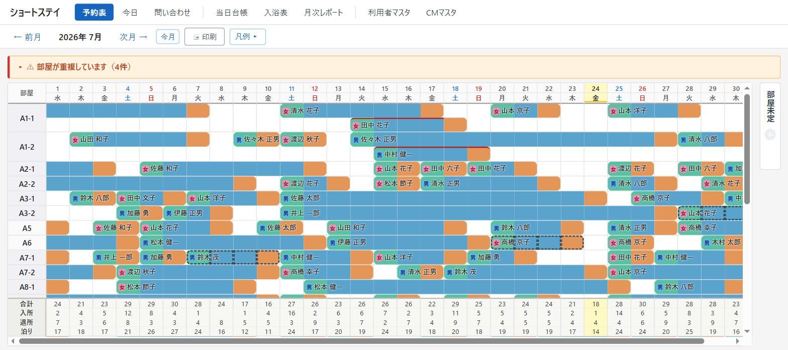
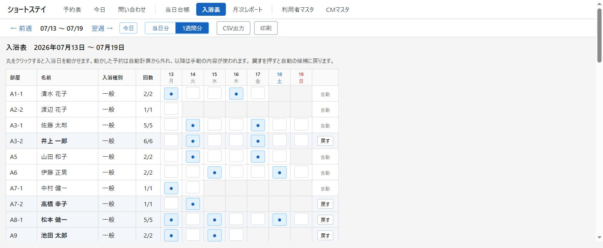
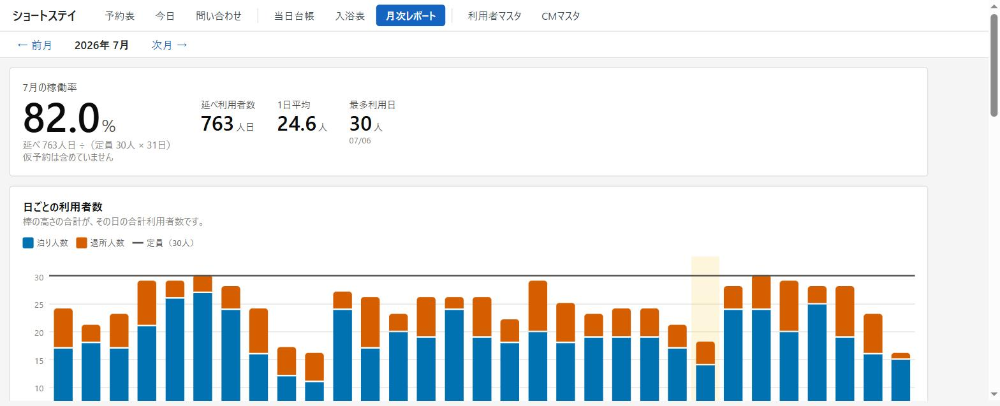
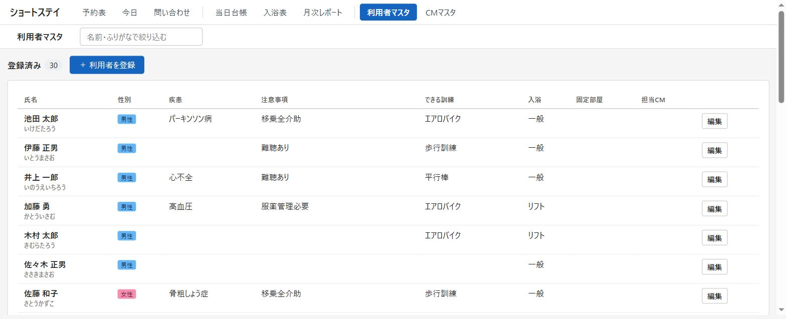

# ショートステイ予約管理システム

介護施設（ショートステイ）の予約・入浴計画・稼働レポートを、ひとつの画面群でまかなう業務システムです。
短期入所の現場で14年間働いてきた視点から、
「既存の介護システムは、現場が本当に困っている細かいところに手が届かない」という実感を出発点に、
設計から実装まで一人で行いました。

> **※ このリポジトリのデータ（利用者名・予約・記録など）はすべて架空です。**
> デモ用にダミーデータを自動生成しており、実在の人物・施設とは一切関係ありません。

---

## 主な機能

- **予約表** — 1か月分の予約を1画面で一望。部屋の重複を自動で検知して警告
- **入浴表** — 入浴予定日を自動計算し、現場都合で手動調整も可能
- **月次レポート** — 稼働率・利用者数の推移をグラフで可視化
- **当日ページ** — その日の入所・退所・稼働状況をまとめて確認
- **利用者マスタ** — 疾患・注意事項・訓練内容など、ケアに必要な情報を管理
- **問い合わせ管理** — 問い合わせ記録とケアマネージャー情報の管理

---

## スクリーンショット

### 予約表
部屋 × 日付のグリッドで、誰がいつ・どの部屋にいるかをひと目で把握できます。
部屋が重複しているとバナーで警告し、クリックすると該当箇所へジャンプします。



### 入浴表
自動計算された入浴予定を、人員の都合に合わせて動かせます。動かした予定は「戻す」でいつでも自動に戻せます。



### 月次レポート
稼働率の計算式をその場に示し、日ごとの利用者数の増減をグラフで確認できます。



### 利用者マスタ
一人ひとりの疾患・注意事項・できる訓練を一覧で管理します。



---

## なぜ作ったか

短期入所の現場で14年働くなかで、業務システム全般に対して感じていた課題がありました。

- **予約の重複に気づくのが遅い** — 当日になって「部屋がかぶっている」と発覚することがある
- **入浴回数の計算が運用に合わない** — 施設ごとのルールに合わず、結局は手で数え直している
- **数字はあるのに、傾向が読めない** — 集計は出るが数値の羅列で、混み具合の波が見えない
- **不慣れな職員がつまずく** — いつものExcel操作ができず、システムに慣れるまでが大変

これらは「現場を知らないと気づけない不便」だと考えています。
実際に毎日使う側の視点から、ひとつずつ潰していくつもりで作りました。

---

## 全体構造

このシステムは、**2種類の元データ**さえ持てば、他の機能はすべてそこから導出できる構造になっています。

### 元データ（入力するもの）

| データ | 性質 | 内容 |
|---|---|---|
| **予約データ** | 日々変わる | 誰が・いつからいつまで・どの部屋に |
| **利用者マスタ** | あまり変わらない | 部屋・疾患・注意事項・訓練・入浴種別・CM |

### 導出されるもの（計算・組み合わせで出るもの）

| 分類 | 内容 | 元データ |
|---|---|---|
| **自動集計** | 入退所人数・合計利用者数・泊り人数・稼働率 | 予約データ |
| **当日帳票** | 当日台帳・入浴表 | 予約データ × 利用者マスタ |
| **記録・連携** | 問い合わせ記録・CM情報の取り込み | （独立。予約データへ変換可能） |

---

## 設計方針

システム全体を通して、次の4つを判断の軸にしています。

### 1. 施設ごとの違いは「設定」で吸収する

施設によって運用が異なる部分は、コードに直接書かず設定で変更できるようにしています。
自分の施設専用ツールではなく、他施設でも使えるシステムにするためです。

該当：入浴種別の選択肢／当日台帳のブロック数／入浴回数の算出ルール／定員

### 2. AIの出力は必ず人が確認する

AIに最終判断をさせません。AIは下書き・提案までを担当し、人が確認・承認して初めて確定します。

該当：書類読み取り（読み取り結果は下書き扱い、人の承認後に登録）／入浴日の自動割り当て（システムは候補を出すのみ、最終調整は手動）

### 3. 現場の例外を止めない

システムがエラーで止めるのではなく、受け付けたうえで「気づける」ようにします。

該当：部屋の重複（現場では普通に発生するためブロックせず、警告表示のみ）／部屋番号が未定の予約（作成を許可し、部屋未定リストで管理）

### 4. 紙運用との併存を前提にする

現場では紙で回す運用が残っているため、CSV出力に対応しています。

該当：入浴表（当日分・1週間分をCSV出力）

---

## 入浴回数の設計

最も設計に悩み、最も力を入れた部分です。

**基本ルール**
- 3日に1回のペースで入浴予定を組む
- ただし **退所日、または退所日前日には必ず入浴を入れる**
  （利用者を清潔な状態で自宅へ送り出すという、現場では当たり前の配慮を仕様に落とし込んでいます）
- 日帰り利用（0泊）は、入浴表に1回分として載せる。
  ショートステイで日帰りになるのはまれで、多くは体調不良による早退（1泊2日の予定だったが、熱が出て当日帰る など）。
  その場合でも初日に入浴を済ませてから帰ることがあるため、表には載せておき、不要ならスタッフが飛ばす運用にしている。
  載っていない人は見落とされるが、余分に載っている人は飛ばせば済むため。`config.toml` の `include_daytrip` を `false` にすると載せなくなる

**現場に合わせて動かせる**
- 人員配置の都合で、入浴予定を手動でずらせる
- 手動でずらした予定は自動計算の対象から外れ、以降はその内容が優先される
- 「戻す」ボタンで、いつでも自動計算の候補に戻せる
- システム操作が苦手な職員向けに、**CSV出力してExcelで編集する経路**も残した

入浴回数を計算ロジックの中に固定してしまわず、**画面上で確認・調整できる形**にしたのは、
入退所当日を回数に含めるかどうかが施設ごとに分かれる、という現場の実情に対応するためです。
「システムが勝手に決める」のではなく「現場が最終判断できる」設計を優先しました。

---

## 実装上の工夫

**予約表を「1画面で一望」するための作り込み**
毎日いちばん触る画面なので、予約表そのものの表示領域を最優先しました。
月次の集計は当日ページ（`/today`）へ分離し、凡例・重複警告・部屋未定パネルは折りたたみ式に。
マスの幅・行の高さ・文字サイズは、実機のタブレットで見え方を確認しながら詰めています。

**色覚特性への配慮**
入所・退所・宿泊中の色分けに、カラーユニバーサルデザイン（CUD）の推奨配色を採用。
色だけに頼らず、帯の位置（左端＝入所・右端＝退所）や「男」「女」のラベルも併用し、
色の見え方に個人差があっても情報が伝わるようにしています。

**数字の根拠を隠さない**
稼働率などの指標は、計算式（例：延べ人日 ÷（定員 × 日数））を画面にそのまま表示し、
仮予約を集計に含めているかどうかも明記しています。

**軽量な構成**
グラフ描画も含め、外部のJavaScriptフレームワークやライブラリに依存せず、
HTML・CSS・少量のJavaScriptだけで構成しています。導入・保守のハードルを下げるための選択です。

---

## 実装フェーズと設計仕様書

積み木のように土台から順に作る。**途中で止めても、そこまでが一つの完成品として成立する**構成にしています。

| # | フェーズ | 仕様ファイル | 依存 |
|---|---|---|---|
| ① | 予約データの入力・管理 | [reservation_spec.md](reservation_spec.md) | なし（土台） |
| ② | 自動集計（人数・稼働率） | [aggregation_spec.md](aggregation_spec.md) | ① |
| ③ | 利用者マスタ | [user_master_spec.md](user_master_spec.md) | なし |
| ④ | 当日帳票（当日台帳・入浴表） | [daily_reports_spec.md](daily_reports_spec.md) | ① と ③ |
| ⑤ | 問い合わせ管理・CM情報の取り込み | [inquiry_spec.md](inquiry_spec.md) | ③／① |

---

## あえて実装しなかった機能

書類（FAX・PDFなど）からのAI自動読み取り機能（⑤の一部）は、検討したうえで見送りました。
現場のやり取りは提供表が中心で、書類読み取りの需要が現状は薄く、
実装・運用のコストに見合わないと判断したためです。
メール中心の運用が増えるなど状況が変われば、追加を検討します。

「実装できる機能をすべて盛り込む」のではなく、現場の実運用に照らして取捨選択しました。

---

## 使用技術

| 分類 | 使用技術 |
|---|---|
| バックエンド | Python / FastAPI |
| テンプレート | Jinja2（サーバーサイドレンダリング） |
| フロントエンド | HTML / CSS / JavaScript（フレームワーク・ライブラリ不使用） |
| データベース | SQLite |

---

## セットアップ

```bash
# リポジトリを取得
git clone https://github.com/ossudesu-lab/kaigo_system.git
cd kaigo_system

# 依存パッケージをインストール
pip install -r requirements.txt

# デモ用ダミーデータを投入（架空データ・乱数固定で毎回同じ結果になります）
python scripts/seed_demo.py --reset

# 起動
python -m uvicorn main:app
```

起動後、ブラウザで `http://127.0.0.1:8000/` を開いてください。

Windows環境で起動しない、あるいは変更が画面に反映されない場合は、
[TROUBLESHOOTING.md](TROUBLESHOOTING.md) を参照してください。

### テスト

```bash
pip install -r requirements.txt -r requirements-dev.txt
python -m pytest
```

テストはメモリ上の一時的なDBで動くので、`kaigo.db` の中身には影響しません。

---

## ライセンス

本リポジトリはポートフォリオとしての公開です。
コードの閲覧は自由ですが、商用利用・再配布についてはご相談ください。
